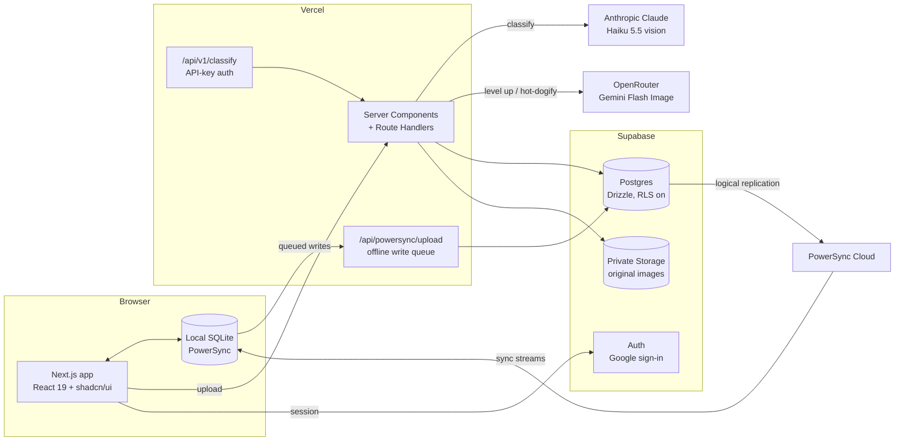

<div align="center">

# 🌭 SeeFood Enterprise

**The decisive food intelligence platform.** Upload any image, get a definitive **Hot Dog** or **Not Hot Dog**.

An enterprise edition of Jian Yang's app from HBO's *Silicon Valley*, built as a production-ready product.

[](https://github.com/furiousteabag/seamflow-home-task/actions/workflows/ci.yml)
[](https://seefoodsystems.com)
[](https://seefoodsystems.com/docs)


[**Website**](https://seefoodsystems.com) · [**App**](https://seefoodsystems.com/app) · [**API reference**](https://seefoodsystems.com/docs) · [**System status**](https://seefoodsystems.com/api/health)

</div>

---

## What it does

| | Feature | Details |
|---|---|---|
| 🎯 | **Classifier** | Claude Haiku 5.5 vision with structured output: verdict, confidence, label and one-line reasoning. Text inside an image is treated as pixels, never as instructions (a sign saying "hot dog" changes nothing). |
| 🖼️ | **Web app** (`/app`) | Upload, drag-and-drop, paste, phone camera or one-click samples. A large verdict banner with confidence, model, latency and scan ID. |
| 🏅 | **Hot Dog Score** | Hot dogs get a 0–100 quality score with a grade and a list of *what's missing*, from the same Claude call. |
| ✨ | **Level it up** | Gemini 3.1 Flash Image (via OpenRouter) applies the missing improvements, then Claude re-scores the result. Shown in a before/after slider. |
| 🌭 | **Hot-dogify** | For *Not Hot Dog* images, the image model adds a hot dog (animals eat it, people hold it), then Claude reclassifies. |
| 📍 | **Hungry?** | Lists the nearest hot dog places from browser geolocation via Komoot Photon (OpenStreetMap). Location is rounded to about 100 m and never stored. |
| 🗂️ | **Scan history** | Audit log with thumbnails, filters, search, CSV export and a full-image viewer (short-lived signed URLs). |
| 👍 | **Feedback** | Confirm or flag each verdict. Flagged scans get their own filter, and analytics shows measured accuracy. |
| 📊 | **Analytics** | Volume, hot dog rate, average confidence and latency, and a 14-day chart. |
| 📴 | **Offline** | History, analytics, feedback and deletes run on a local SQLite replica ([PowerSync](https://powersync.com)) and sync when you reconnect. Try *Go offline* in the sidebar. |
| 🔑 | **REST API** | `POST /api/v1/classify` with bearer keys (`sf_live_…`). Keys are shown once, stored as SHA-256 hashes and revocable. API scans get server-side thumbnails (sharp). |
| 🏢 | **Website** | Marketing site, API reference, privacy policy and terms, with SEO and OpenGraph metadata. |

## Architecture



Reads in the app come from the local database, so they're instant and work offline. Writes go through server routes that validate the session and scope every row to the signed-in user.

## API quickstart

Create a key under **API keys** in the app, then:

```bash
curl https://seefoodsystems.com/api/v1/classify \
  -H "Authorization: Bearer $SEEFOOD_API_KEY" \
  -F image=@lunch.jpg
```

```json
{
  "verdict": "hot_dog",
  "is_hot_dog": true,
  "confidence": 0.98,
  "label": "two hot dogs with mustard on plate",
  "reasoning": "A sausage served in a sliced bun with mustard.",
  "model": "claude-haiku-5-5",
  "latency_ms": 1547,
  "hot_dog_score": 82
}
```

Errors are typed JSON (`{ "error": { "code", "message" } }`): `401 invalid_api_key`, `400 missing_image`, `415 unsupported_type`, `429 rate_limited`. Full reference: [seefoodsystems.com/docs](https://seefoodsystems.com/docs).

## Production concerns covered

- **Security:**
  - Google-only sign-in via Supabase Auth (anonymous sign-ins are disabled); each account is its own workspace.
  - Every write is scoped to the session user.
  - Postgres RLS is on with no policies, so Supabase's public REST API is closed.
  - Original images live in a private Storage bucket and are served through short-lived signed URLs.
- **Input validation:**
  - The file type is checked from the image bytes (JPEG, PNG, WebP), max 5 MB.
  - The client downscales to 1280 px before upload.
- **Abuse limits:**
  - 20 scans per minute per workspace (web and API combined).
  - 50 level-ups or hot-dogifies per 10 minutes per user, logged in `level_ups`.
  - 10 API keys per workspace.
- **Errors:**
  - Typed JSON errors everywhere.
  - If classification fails, the stored image is deleted so nothing is orphaned.
- **Operations:**
  - CI runs lint/format (Biome), typecheck, migration drift and build checks.
  - Drizzle migrations run automatically on production deploys.
  - `/api/health` checks the database.

## Stack

Next.js 16 (App Router, Cache Components) · Tailwind 4 + shadcn/ui · Supabase (Postgres, Auth, Storage) · Drizzle ORM · Vercel AI SDK + Anthropic · OpenRouter · PowerSync · Vercel

## Run locally

```bash
pnpm install
cp .env.example .env.local   # fill in the values below
pnpm db:migrate
pnpm dev
```

| Variable | Used for |
|---|---|
| `DATABASE_URL` | Supabase Postgres (transaction pooler, port 6543) |
| `ANTHROPIC_API_KEY` | Claude classification |
| `NEXT_PUBLIC_SUPABASE_URL`, `NEXT_PUBLIC_SUPABASE_PUBLISHABLE_KEY` | Auth in the browser |
| `SUPABASE_SECRET_KEY` | Server-only, private Storage |
| `OPENROUTER_API_KEY` | Level it up and Hot-dogify |
| `NEXT_PUBLIC_POWERSYNC_URL` | Offline sync |
| `POWERSYNC_DATABASE_PASSWORD` | Only for deploying `powersync/` with the CLI |

PowerSync instance config lives in `powersync/` and deploys with `npx powersync deploy`. One-time database setup is in `powersync/setup.sql`.

## Layout

```
src/app/page.tsx              marketing site
src/app/docs/                 API reference
src/app/app/                  authenticated app (classify, history, analytics, api-keys)
src/app/api/classify          web upload endpoint (session auth)
src/app/api/v1/classify       public REST API (API-key auth)
src/app/api/scans/[id]/enhance  Level it up / Hot-dogify
src/app/api/hot-dog-places    "Hungry?" nearby places lookup
src/app/api/powersync/upload  applies offline writes from the sync queue
src/lib/classify.ts           vision prompt + structured output
src/lib/scans.ts              validation, rate limit, storage, persistence
src/db/schema.ts              Drizzle schema (migrations in drizzle/)
powersync/                    sync streams + instance config
```

---

<sub>A parody of SeeFood from HBO's <i>Silicon Valley</i>. All customers and people named on the website are fictional. Built in a 3-hour home task, with Claude Code.</sub>
