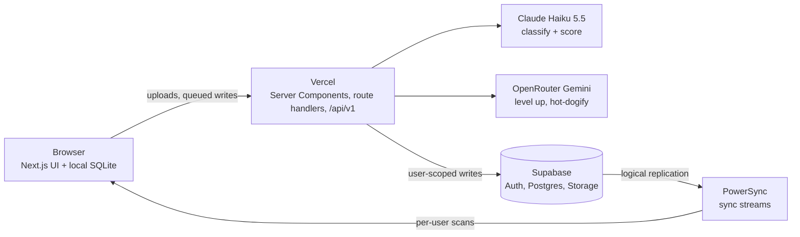

# SeeFood Enterprise

Upload an image, get a definitive **Hot Dog** or **Not Hot Dog**. An enterprise edition of Jian Yang's app from HBO's *Silicon Valley*.

[](https://github.com/furiousteabag/seamflow-home-task/actions/workflows/ci.yml)

[Website](https://seefoodsystems.com) · [App](https://seefoodsystems.com/app) · [API reference](https://seefoodsystems.com/docs)

## Features

| Feature | Details |
|---|---|
| Classifier | Claude Haiku 5.5 vision, structured output: verdict, confidence, label, reasoning. Text in images is treated as content, not instructions. |
| Web app | Upload, drag-and-drop, paste, camera or samples. Verdict with confidence, model, latency and scan ID. |
| Hot Dog Score | 0–100 score with a grade and what's missing, from the same Claude call. |
| Level it up | Gemini 3.1 Flash Image (OpenRouter) applies the improvements, Claude re-scores. Before/after slider. |
| Hot-dogify | For Not Hot Dog images, the image model adds a hot dog, then Claude reclassifies. |
| Hungry? | Nearest hot dog places via Komoot Photon (OpenStreetMap). Location rounded to ~100 m, never stored. |
| History | Audit log with thumbnails, filters, search, CSV export, full-image viewer (signed URLs). |
| Feedback | Confirm or flag each verdict; analytics shows measured accuracy. |
| Analytics | Volume, hot dog rate, confidence, latency, 14-day chart. |
| Offline | History, analytics, feedback and deletes run on local SQLite ([PowerSync](https://powersync.com)) and sync on reconnect. |
| REST API | `POST /api/v1/classify` with `sf_live_…` bearer keys, shown once, stored as SHA-256, revocable. |

## Architecture



## API

```bash
curl https://seefoodsystems.com/api/v1/classify \
  -H "Authorization: Bearer $SEEFOOD_API_KEY" \
  -F image=@lunch.jpg
```

```json
{ "verdict": "hot_dog", "is_hot_dog": true, "confidence": 0.98, "label": "two hot dogs with mustard on plate" }
```

Errors: `401 invalid_api_key`, `400 missing_image`, `415 unsupported_type`, `429 rate_limited`. Full reference at [/docs](https://seefoodsystems.com/docs).

## Production concerns

- **Auth:** Google sign-in via Supabase; each account is its own workspace. All writes are scoped to the session user.
- **Data:** Postgres RLS on with no policies (Supabase REST API closed). Images in a private bucket, served via short-lived signed URLs.
- **Validation:** type checked from bytes (JPEG, PNG, WebP), 5 MB max; client downscales to 1280 px.
- **Limits:** 20 scans/min per workspace; 50 level-ups per 10 min per user; 10 API keys per workspace.
- **Errors:** typed JSON `{ error: { code, message } }`; failed classifications delete the stored image.
- **Ops:** CI runs Biome, typecheck, migration drift and build. Migrations run on production deploys. `/api/health` checks the database.

## Stack

Next.js 16 · Tailwind 4 + shadcn/ui · Supabase · Drizzle · Vercel AI SDK + Anthropic · OpenRouter · PowerSync · Vercel

## Run locally

```bash
pnpm install
cp .env.example .env.local
pnpm db:migrate
pnpm dev
```

| Variable | Purpose |
|---|---|
| `DATABASE_URL` | Supabase Postgres, transaction pooler (6543) |
| `ANTHROPIC_API_KEY` | Classification |
| `NEXT_PUBLIC_SUPABASE_URL`, `NEXT_PUBLIC_SUPABASE_PUBLISHABLE_KEY` | Browser auth |
| `SUPABASE_SECRET_KEY` | Server-only Storage access |
| `OPENROUTER_API_KEY` | Level it up, Hot-dogify |
| `NEXT_PUBLIC_POWERSYNC_URL` | Offline sync |
| `POWERSYNC_DATABASE_PASSWORD` | Only for `npx powersync deploy` |

PowerSync config is in `powersync/`; one-time database setup in `powersync/setup.sql`.

## Layout

```
src/app/page.tsx                 website
src/app/docs/                    API reference
src/app/app/                     app: classify, history, analytics, api-keys
src/app/api/classify             web upload (session auth)
src/app/api/v1/classify          public API (key auth)
src/app/api/scans/[id]/enhance   level up, hot-dogify
src/app/api/hot-dog-places       nearby places
src/app/api/powersync/upload     offline write queue
src/lib/classify.ts              prompt + structured output
src/lib/scans.ts                 validation, rate limit, storage
src/db/schema.ts                 schema; migrations in drizzle/
powersync/                       sync streams + instance config
```

Parody of SeeFood from *Silicon Valley*. Customers and people named on the website are fictional.
